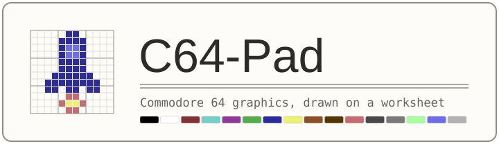
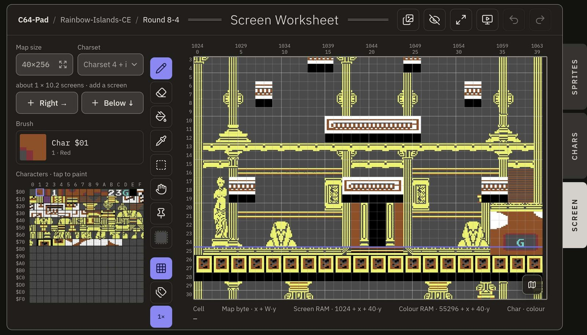

<p align="center">
  
</p>

<p align="center">
  <strong>Draw Commodore 64 sprites, character sets and screens on a tablet, or anywhere else.</strong>
</p>

<p align="center">
  <a href="docs/userguide/README.md"><strong>📖 Read the user guide</strong></a>
</p>

---

C64-Pad is a touch-first editor for C64 graphics, modelled on the paper
worksheets C64 artists used to plan their work. It keeps everything inside
what the real hardware can show, runs your work on a built-in C64 emulator,
and exports it for your own programs.

- **Sprite Worksheet**: hires and multicolour sprites, hires overlays,
  animations, X/Y expand
- **Character Worksheet**: hires, multicolour, ECM and multicolour bitmap
  charsets, PETSCII starters, char attributes for game code
- **Screen Worksheet**: maps from one screen up to 1024 × 1024 chars, block
  brushes, a Navigator for big levels
- **Tracing paper**: draw over a reference image
- **Run on C64**: see it on the built-in c64-ready emulator and save a `.prg`
- **Export**: raw `.bin`, KickAssembler source, SpritePad `.spd`, CharPad
  `.ctm`, Koala `.kla` and PNG
- **Import**: Aseprite files (tilemaps as charsets and screens; frames
  and sprite sheets as sprite sets, with tags as animations), and assets
  from other projects
- **Moves with you**: `.c64pad` project files, or the cloud (Google Drive,
  Dropbox or a DigitalOcean Space)
- Stylus, finger, mouse or gamepad; light and dark; works offline

<p align="center">
  
</p>

## Quickstart

### 1. Run it

You need [Node.js](https://nodejs.org/) (version 24 is what CI uses).

```bash
git clone https://github.com/hayesmaker/c64-pad.git
cd c64-pad
npm install
npm run dev
```

Open <http://localhost:3000> in your browser. (To try it from a tablet on the
same network, run `npm run dev -- --host` and open the address it prints.)
A fuller install guide, including the Android app, is on the way;
until then, developer notes are in [docs/development.md](docs/development.md).

### 2. Draw a sprite

1. Tap **New project**, name it and tap **Create**.
2. Tap the **Sprites 1** card to open the Sprite Worksheet.
3. Draw on the grid. Double-tap a pixel to clear it; pinch to zoom.
4. Under _Sprite mode_, tap **Multi-colour** for four colours with wide
   pixels, and pick a pen to draw with.

### 3. Build a screen

1. Tap **CHARS** on the right edge of the sheet and draw a few characters.
2. Tap **SCREEN**, pick a char from the brush panel and paint it onto the
   map.

### 4. See it on a C64

Tap **Run & export** → **Run on C64** → **Run**. When you're happy, use
**Export files** to save it for your assembler.

Everything saves automatically on your device. To back up a project, use
**⋮ → Export** on My Projects, or **Save to cloud**.

## User guide

| Section                                                                 | What's in it                                             |
| ----------------------------------------------------------------------- | -------------------------------------------------------- |
| [Getting started](docs/userguide/01-getting-started.md)                 | Projects and assets, finding your way around, saving     |
| [Projects](docs/userguide/02-projects.md)                               | My Projects, the Project Worksheet, palettes, imports    |
| [Drawing on the grids](docs/userguide/03-drawing-on-the-grids.md)       | Tools, gestures, undo, Zen mode, gamepads, small screens |
| [Sprites](docs/userguide/04-sprites.md)                                 | Multicolour, overlays, animation                         |
| [Characters](docs/userguide/05-characters.md)                           | Charset modes, PETSCII, ECM, bitmap tiles, attributes    |
| [Screens](docs/userguide/06-screens.md)                                 | Brushes, block brushes, big maps, the Navigator          |
| [Tracing paper](docs/userguide/07-tracing-paper.md)                     | Drawing over reference images, tracing chars             |
| [Run and export](docs/userguide/08-run-and-export.md)                   | The built-in C64 and every export format                 |
| [Moving projects between devices](docs/userguide/09-moving-projects.md) | Project files and the cloud                              |
| [C64 graphics basics](docs/userguide/10-c64-graphics-basics.md)         | The hardware rules behind the worksheets, and a glossary |

## More

- [Using sprite exports in KickAssembler](docs/kickass-sprites.md)
- [Using charset and map exports in KickAssembler](docs/kickass-chars.md)
- [Setting up a DigitalOcean Space for the cloud](docs/cloud.md)
- [Developing C64-Pad](docs/development.md): tests, linting, Android builds
