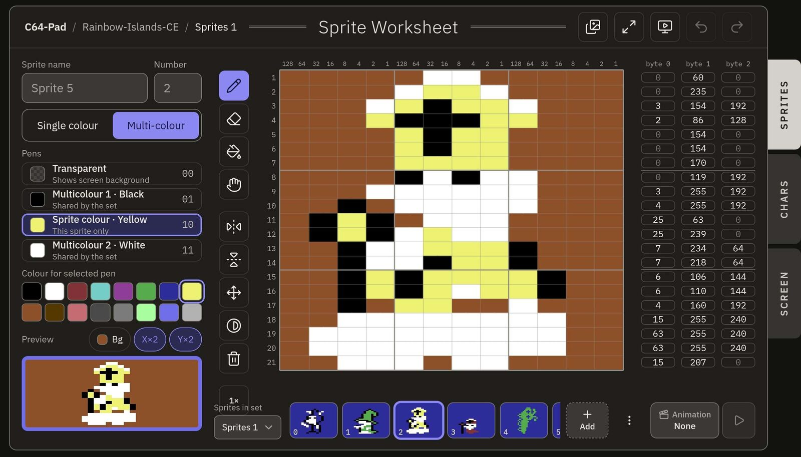
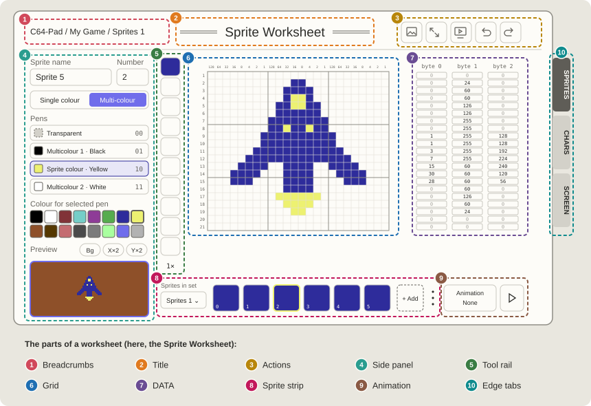

# Getting started

[User guide](README.md) › Getting started

## The idea

C64-Pad is modelled on the paper worksheets C64 artists used to plan graphics
by hand. Each editor is a **worksheet**: a sheet of paper on a desk, with a
grid, bit-weight headers, row numbers and a live column of the bytes your
drawing makes. Change a pixel and you see the number the C64 will read.

The worksheets only let you do what the C64 can do. A multicolour sprite has
wide pixels and four colours; a hires character has one colour of its own; a
screen is built from the 256 chars of one charset. You don't need to know the
rules in advance (C64-Pad enforces them), but
[C64 graphics basics](10-c64-graphics-basics.md) explains them if you're
curious.

## Projects and assets

Everything you make lives in a **project**. A project holds any number of:

| Asset             | What it is                                                       | Edited on               |
| ----------------- | ---------------------------------------------------------------- | ----------------------- |
| **Sprite set**    | A list of sprites that share two multicolours, plus animations   | the Sprite Worksheet    |
| **Character set** | 256 characters (chars) of 8 × 8 pixels, with their colours       | the Character Worksheet |
| **Screen map**    | A grid of chars from one charset: a title screen, a level, a HUD | the Screen Worksheet    |

A new project starts with one of each: _Sprites 1_, _Charset 1_ and _Map 1_
(a single 40 × 25 screen using Charset 1), so you can start drawing straight
away.

## Your first five minutes

1. On **My Projects**, tap **New project**, give it a name and tap
   **Create**. You land on the project's **Project Worksheet**.
2. Tap the **Sprites 1** card. The Sprite Worksheet opens with sprite 0.
3. Draw on the grid with a finger, stylus or mouse. Double-tap a pixel to
   clear it again.
4. Tap **Multi-colour** under _Sprite mode_ and pick one of the coloured pens
   to draw with wide multicolour pixels.
5. Tap the **CHARS** tab on the right edge of the sheet to draw a character,
   then **SCREEN** to paint it onto a screen.
6. Tap **Run & export**, choose **Run on C64** and tap **Run** to see your
   work on the built-in C64.

There's no Save button: C64-Pad saves as you go.

## Finding your way around

The numbers match the diagram. Every page has parts 1 to 3:

1. **Breadcrumbs** at the top left: `C64-Pad / Project / Asset`. Tap
   _My Projects_ or the project's name to go back up.
2. **The title** in the middle between double rules: _My Projects_,
   _Project Worksheet_, _Sprite Worksheet_, _Character Worksheet_ or
   _Screen Worksheet_.
3. **Actions** at the top right. In the editors they're icon buttons:

   | Icon                     | Button                                           |
   | ------------------------ | ------------------------------------------------ |
   | Pictures                 | **Tracing paper** (Sprite and Screen Worksheets) |
   | Eye                      | Show / hide the tracing paper, once there is one |
   | Arrows pointing outwards | **Zen mode**                                     |
   | Screen with a play arrow | **Run & export**                                 |
   | Curved arrows            | **Undo** and **Redo**                            |

   Hold a pointer over a button (or long-press) to see its name.

The editors add the rest. The diagram shows the Sprite Worksheet; the
Character and Screen Worksheets arrange the same kinds of part a little
differently (see their chapters).

4. **Side panel**: the settings for what you're drawing, such as its name,
   mode, pens, colours and a preview.
5. **Tool rail**: Draw, Erase, Fill, Hand and the other tools. See
   [Drawing on the grids](03-drawing-on-the-grids.md).
6. **Grid**: where you draw, with the bit values across the top.
7. **DATA**: the bytes behind each row of the grid, updated as you draw.
8. **Sprite strip**: every sprite in the set, the **Sprites in set** menu and
   **Add**. See [Sprites](04-sprites.md).
9. **Animation**: choose, edit and play the set's animations.
10. **Edge tabs** on the right edge of the sheet in the editors: **SPRITES**,
    **CHARS** and **SCREEN**. They jump between editors in the same project.

The edge tabs try to take you to what you need next:

- **CHARS** from a screen opens _that screen's_ charset.
- **SCREEN** from a charset opens a screen that uses it (the one you last had
  open, if it does).
- Otherwise each tab goes back to the sprite set, charset or screen you last
  opened, or the first one in the project.

If the project has none of that kind yet, the tab takes you to the Project
Worksheet so you can add one.

## Saving

C64-Pad saves every change automatically, a moment after you make it, to your
device's storage. You can close the app or browser tab at any time.

- If a save ever fails, a **Not saved** warning appears in the header with
  the reason. It tries again on your next change.
- Projects are kept **on this device only** (in the browser's storage on the
  desktop, in the app's storage on Android). Clearing the browser's site data
  or uninstalling the app removes them. To keep a copy somewhere else, export
  a project file or save to the cloud: see
  [Moving projects between devices](09-moving-projects.md).

## Light and dark

C64-Pad follows your device's light or dark setting. In dark mode the
worksheet becomes "a desk at night"; the C64 colours inside the grids and
previews never change.

## Devices

- **Tablets** (landscape) are the main target: big touch targets, stylus
  and finger both work, and the palm is ignored while you use a stylus.
- **Desktop browsers** work with a mouse and keyboard, with wheel zoom and
  keyboard shortcuts.
- **Small screens** such as handhelds and phones get a compact layout, with
  side panels tucked into drawers. See
  [Drawing on the grids](03-drawing-on-the-grids.md#small-screens).
- **Gamepads** can drive the sprite and character grids. See
  [Gamepad](03-drawing-on-the-grids.md#gamepad).

---

Next: [Projects](02-projects.md)
