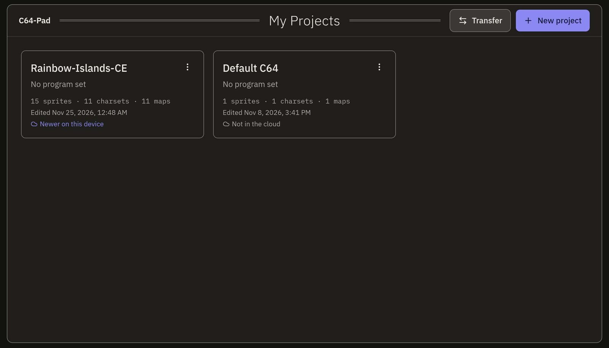
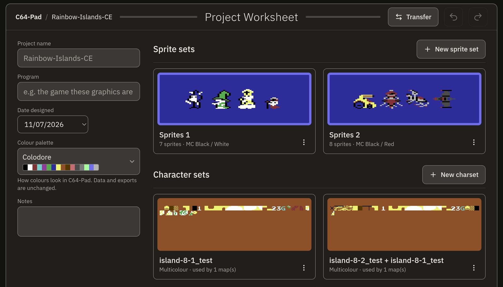

# Projects

[User guide](README.md) › Projects

## My Projects

The home page lists every project on this device as a card, showing its name,
its program, how many sprites, charsets and maps it holds, and when it was
last edited. Tap a card to open it.

- **New project** (top right) asks for a name and opens the new project.
- **Transfer** (top right) brings projects in from elsewhere:
  - **Cloud** opens your cloud storage, to open or download projects saved
    from another device.
  - **Import** opens a `.c64pad` project file.

  Both are covered in [Moving projects between devices](09-moving-projects.md).

Each card's **⋮** menu has:

| Action                | What it does                                                                                       |
| --------------------- | -------------------------------------------------------------------------------------------------- |
| **Rename**            | Changes the project's name.                                                                        |
| **Duplicate**         | Makes a full copy called "… copy".                                                                 |
| **Export**            | Saves the whole project as a `.c64pad` file.                                                       |
| **Save to cloud**     | Uploads it to your cloud storage (you're asked to set the cloud up the first time).                |
| **Update from cloud** | Shown when the cloud copy is newer: brings it to this device.                                      |
| **Discard changes…**  | Shown when this device's copy differs from the cloud's: replaces it with the cloud copy.           |
| **Delete**            | Removes the project from this device. This can't be undone, so export it first if you want a copy. |

When the cloud is set up, each card also shows how it compares with the cloud
copy, e.g. _Up to date_ or _Newer on this device_.

## The Project Worksheet

Opening a project shows its **Project Worksheet**: the project's details on
the left and all its assets on the right.

### Project details

| Field              | Use                                                                    |
| ------------------ | ---------------------------------------------------------------------- |
| **Project name**   | Shown on My Projects and used to name exported files.                  |
| **Program**        | The game or demo these graphics are for (shown on the project's card). |
| **Date designed**  | Like the box on a paper worksheet; it starts as the day you made it.   |
| **Colour palette** | How the 16 C64 colours look in C64-Pad (see below).                    |
| **Notes**          | Anything you like.                                                     |

### Colour palette

Emulators and monitors disagree on exactly what the C64's 16 colours look
like, so each project can pick its palette: **Colodore** (the default),
**Pepto**, **VICE**, **CCS64**, **Frodo**, **C64HQ** or **Community Colors**.

The palette only changes how colours **look** in C64-Pad, including PNG
exports. Your drawings store colour _numbers_ (0 to 15), so the data and every
other export are exactly the same whichever palette you pick.

### Assets

The right side has three sections: **Sprite sets**, **Character sets** and
**Screen maps**. Each asset is a card with a thumbnail; tap it to open its
worksheet.

- **New sprite set** adds a set with one blank sprite.
- **New charset** asks for a name and how to start:
  - **Blank**: 256 empty chars.
  - **PETSCII upper**: the C64's built-in upper case and graphics characters.
  - **PETSCII lower**: the built-in lower and upper case characters.
- **New map** asks for a name, a size and which charset it uses. The size
  presets are in whole screens (one screen is 40 × 25 chars); type a width and
  height for anything else, up to 1024 × 1024. You need at least one charset
  before you can add a map.

Each card's **⋮** menu has **Rename**, **Duplicate** and **Delete**.
Charsets also have **Merge chars into new charset…** (see below).

**Deleting a charset that maps use** asks you to choose another charset for
those maps first (**Move maps and delete**). The maps keep their look where
they can: each cell is switched to the char in the new charset that looks the
same.

### Undo on the Project Worksheet

**Undo** and **Redo** in the header cover everything on this page: typing in
the fields, the palette, adding, renaming, duplicating and deleting assets,
merges and imports. One import or merge is one undo step.

## Merging charsets

**Merge chars into new charset…** (on a charset's ⋮ menu) combines two
charsets without touching either of them. It's handy after an Aseprite import,
or when two screens should share one charset.

1. Open the menu on the charset whose chars you want to **add**.
2. Under **Merge with**, pick the charset to **add them to** (the base).
3. Choose which chars come across: **All used chars** (every char a map
   uses), **None**, or tap chars in the sheet to pick them one by one.
4. Check the **Result** preview. The base's chars stay in their slots, so its
   maps work with the new charset unchanged. Added chars are outlined.
5. Name the new charset and tap **Create charset**.

The added chars go into the base's empty slots that no map uses. Chars that
already exist in the base are reused rather than copied. If the two charsets
use different colour registers, the dialog lists any chars that won't look
the same.

Nothing else changes: your old charsets and maps are left as they were. When
you're ready, switch a map to the new charset on the Screen Worksheet (see
[Changing a map's charset](06-screens.md#changing-a-maps-charset)), then
delete the old charsets if you no longer need them.

## Importing into a project

The Project Worksheet's **Transfer** button brings designs in from outside.
Imports only ever **add** to the project; nothing already there is changed
(apart from the palette, if you choose to switch it).

### From another project

**Transfer → From project** copies sprite sets, charsets and screens from
another project, either **On this device** or **In the cloud**.

1. Pick the project to import from.
2. Tick the items you want. Each one is marked:
   - **Not in this project**: it comes in as new.
   - **Already here**: this project has the very same item, unchanged, so
     there's nothing to import.
   - **Changed: adds a copy**: this project has the same item (the two
     projects are copies of each other, for example via an export or the
     cloud) but one side has changed it. It comes in as a copy beside your
     own, named "Item (Other project)".
   - **Needed by a screen**: a charset that a ticked screen uses, so it comes
     too.
3. Tap **Import**.

### From Aseprite

**Transfer → Import Aseprite** reads an `.aseprite` (or `.ase`) file:

- a **tilemap layer** becomes a **charset and a screen map**;
- **image layers** become a **sprite set**, with animations from the file's
  tags.

If a file has both, the dialog asks what to **Import as**. Either way, the
dialog starts with a ✓ or ✗ for each check on the file (any ✗ blocks the
import, with the reason), then how the file's colours match the C64
palettes:

- If the file uses a different palette from the project (Aseprite's
  _Commodore 64_ palette is **Pepto**), choose to **Switch project to …** or
  **Keep …**. Both import identical data; this only changes how the project
  looks.
- Colours that aren't close to any C64 palette are listed, and matched to
  the nearest C64 colour.

One **Undo** on the Project Worksheet removes the whole import.

#### Charset and screen (tilemap)

What the file needs:

- A tilemap layer (in Aseprite: _Layer › New › New Tilemap Layer_) with
  something on it in frame 1.
- 8 × 8 tiles, embedded in the file, at most 256 of them including Aseprite's
  empty tile 0.
- No flipped or rotated tiles (the C64 can't flip chars).
- A canvas of at most 1024 × 1024 chars, with the tilemap on the 8-pixel grid.

If the file has several tilemap layers, choose one. Under **C64 colours**,
C64-Pad works out a **Background**, **MC1** and **MC2** that fit as many
tiles as possible, and whether the charset needs to be hires or multicolour.
You can change the three colours (**Reset colours** puts its choice back).
Tiles that don't fit exactly are listed with the reason; they still import,
as close as possible.

It **adds** a new charset and a new screen map using it, both named after the
file. Untick the map to import just the chars.

Tile tags (user data on tiles in Aseprite, such as "solid") become
[char attributes](05-characters.md#char-attributes): each different tag gets
its own attribute number and name. A tag of "1" to "15" is used as that
number.

The map is the full canvas size: if the tilemap sits partway down the canvas,
the cells above it are filled with the map's Blank Char.

#### Sprites (image layers)

Each frame's **visible image layers** are flattened, the way Aseprite shows
them, and cut into sprites:

- A **24 × 21** canvas is **one sprite per frame**: an animation.
- A bigger canvas is a **sheet**: a grid of 24 × 21 sprites (e.g. 96 × 42 is
  eight), read left to right, top to bottom, frame by frame.
- With Aseprite's **2:1 pixel ratio** (_Sprite › Properties_), cells are
  **12 × 21** and every pixel is one double-wide multicolour pixel.

The canvas must be an exact grid of cells. Empty cells are left out, and
repeated ones share one sprite. Hidden layers and layers in hidden groups
aren't drawn.

Under **C64 colours**, C64-Pad fits each sprite in one of three ways,
choosing the set's shared **MC1** and **MC2** so as many sprites as possible
fit exactly:

| Fit                              | When                                                                                                                                                                         |
| -------------------------------- | ---------------------------------------------------------------------------------------------------------------------------------------------------------------------------- |
| **Hires**                        | The sprite uses one colour.                                                                                                                                                  |
| **Multicolour**                  | Its pixels are all double-wide, in MC1, MC2 and one colour of its own.                                                                                                       |
| **Multicolour + hi-res overlay** | One colour is drawn in single pixels (outlines, eyes, highlights): that colour goes to a hires [overlay](04-sprites.md#overlays) in front, and the rest fits as multicolour. |

Change MC1 and MC2 if you like (**Reset colours** puts C64-Pad's choice
back). Sprites that don't fit exactly are listed with the reason, and
imported as close as possible. A preview shows the sprites as they'll look.

Transparent pixels are see-through. If the art has **no transparent pixels**
(it's drawn on a solid background), the most common colour in the cells'
corners is read as see-through instead; change it with **See-through**.

It **adds** a new sprite set named after the file. When each frame is one
sprite, each Aseprite **tag** becomes an animation of the same name:

| Tag direction                 | Animation                           |
| ----------------------------- | ----------------------------------- |
| Forward                       | Loop                                |
| Reverse                       | Loop, frames in reverse order       |
| Ping-pong / ping-pong reverse | Ping-pong (reversed for the latter) |

Its speed comes from the frames' durations (20 ms is one PAL frame, so
100 ms frames give a speed of 5). Sprites in a tag are named after it
("walk 0", "walk 1", …). A file with several frames and no tags gets one
animation of all its frames. On a sheet (several sprites per frame), tags are
left out.

A set holds up to 256 sprites, overlays included.

---

Previous: [Getting started](01-getting-started.md) · Next:
[Drawing on the grids](03-drawing-on-the-grids.md)
