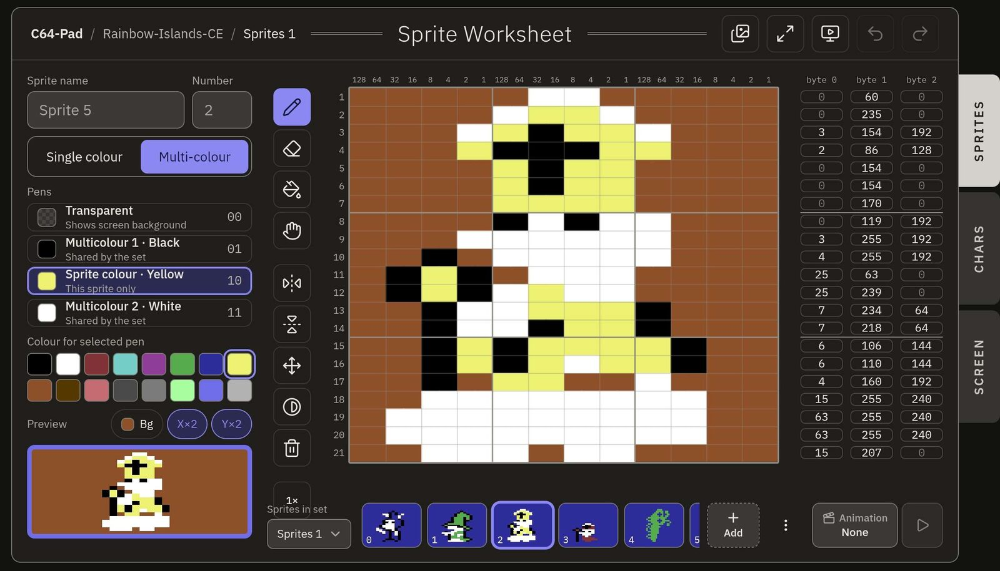

# Sprites

[User guide](README.md) › Sprites

Sprites are the C64's movable objects: players, enemies, bullets, pointers.
Each is **24 × 21 pixels**, and the hardware shows eight at a time (more with
programming tricks). In C64-Pad sprites live in **sprite sets**, edited on the
**Sprite Worksheet**.

## The Sprite Worksheet

- **Left panel**: the sprite's name, number, mode and notes, the pens and
  colours, and a live preview.
- **Middle**: the tool rail and the 24 × 21 grid, with the bit headers
  (`128 … 1` three times, one per byte) and row numbers.
- **Right**: the DATA column, three bytes per row (byte 0, 1 and 2).
- **Bottom**: the **sprite strip**: the set menu, every sprite in the set,
  **Add**, the sprite actions (**⋮**), and the **Animation** menu with its
  **Play** button.

Heavy lines on the grid mark the byte boundaries (every 8 pixels across) and
bands of 7 rows, as on a paper worksheet.

## Sprite sets

A sprite set is an ordered list of sprites that share **two multicolours**,
just as all eight hardware sprites share the same two multicolour registers.
Use one set per group of sprites that appear together, such as a player and
their animations.

The **Sprites in set** menu at the left of the strip switches to another set
in the project. Add new sets on the [Project Worksheet](02-projects.md#assets),
or [import them from Aseprite](02-projects.md#from-aseprite).

## Sprite details

| Field           | Use                                                                           |
| --------------- | ----------------------------------------------------------------------------- |
| **Sprite name** | Used in KickAssembler exports as a label.                                     |
| **Number**      | Its position in the set, from 0. Change it by moving the sprite in the strip. |
| **Sprite mode** | **Single colour** (hires) or **Multi-colour**.                                |
| **Notes**       | Anything you like.                                                            |

### Single colour and multicolour

- **Single colour** (hires): 24 × 21 pixels, each either transparent or the
  sprite's colour.
- **Multi-colour**: 12 × 21 pixels that are each **two pixels wide**, in four
  colours: transparent, the sprite's own colour and the set's two
  multicolours.

Switching mode keeps the same bytes and reads them the other way, just as the
C64 would: a hires drawing seen as multicolour turns each pair of pixels into
one wide pixel. Switch back and it's exactly as it was.

## Pens and colours

| Pen               | Bits | Colour comes from                         |
| ----------------- | ---- | ----------------------------------------- |
| **Transparent**   | `00` | Nothing: the screen shows through         |
| **Multicolour 1** | `01` | Shared by every sprite in the set ($D025) |
| **Sprite colour** | `10` | This sprite only ($D027 and on)           |
| **Multicolour 2** | `11` | Shared by every sprite in the set ($D026) |

A single colour sprite uses just **Transparent** and **Sprite colour**.

Pick a coloured pen, then a colour from the grid to change it. Changing
Multicolour 1 or 2 changes every sprite in the set.

## The preview

The preview shows the sprite at its real size on a C64-style screen.

- **X×2** and **Y×2** preview the sprite with the C64's expand bits: double
  width and double height. They're saved with the sprite and used by Run.
- **Bg** picks the background colour behind the grid, the preview and Run
  (or plain paper). It's a setting on this device, not part of the sprite.

## The sprite strip

Tap a sprite in the strip to edit it. **Add** adds a blank sprite at the end.
The **Sprite actions** menu (⋮) works on the selected sprite:

| Action                             | What it does                                                                             |
| ---------------------------------- | ---------------------------------------------------------------------------------------- |
| **Duplicate sprite**               | Inserts a copy after it. On an overlay pair, **Duplicate sprite + overlay** copies both. |
| **Copy pixels** / **Paste pixels** | Copies the drawing to paste into another sprite (a toast confirms the copy).             |
| **Add hi-res overlay**             | Adds a new hires sprite drawn over this one (see below).                                 |
| **Overlay with sprite…**           | Uses an existing sprite as this one's overlay.                                           |
| **Separate overlay**               | Unlinks an overlay pair; both sprites stay in the set.                                   |
| **Move left** / **Move right**     | Reorders the sprite, which changes its number.                                           |
| **Delete sprite**                  | Removes it, and takes it out of any animations and overlay pairs.                        |

## Overlays

A common C64 trick is to put a **hires sprite over a multicolour one**: the
multicolour sprite gives the body four colours, the hires sprite on top adds
sharp single-pixel outlines or details. Together they act as one sprite.

- **Add hi-res overlay** makes a new hires sprite linked to the selected one.
  Or use **Overlay with sprite…** to link one you've already drawn.
- In the strip, the overlay is marked as the **front layer, drawn over**
  its base sprite. Tap either one to edit that layer; the grid shows the
  other layer faded, so you can line them up.
- The preview, animations and Run show the pair combined.
- **Separate overlay** unlinks them again.

An overlay can't have an overlay of its own.

## Animation

Animations are sequences of sprites from the set, played in the preview and
by Run.

1. Tap the **Animation** button at the right of the strip and choose
   **New animation**. The **Edit animation** window opens.
2. Tap sprites to add them as frames, in order. Frames can be reordered
   (**Move frame left / right**) or removed (**Remove frame**). The same
   sprite can appear more than once.
3. Set the **Speed** in PAL frames per step: 1 is fifty steps a second, 10 is
   five a second.
4. Choose a **Play mode**: **Loop** (1 2 3 1 2 3…) or **Ping-pong**
   (1 2 3 2 1…).
5. Tap **Done**.

Pick an animation from the **Animation** menu to select it, and tap **Play**
(the arrow beside it) to watch it in the preview. **Edit "…"** in the same
menu changes it, and **Delete animation** in the edit window removes it. A
set can have as many animations as you like; choose **None** to go back to
the single sprite.

Overlays play with their sprite: add the base sprite as a frame and its
overlay comes along.

---

Previous: [Drawing on the grids](03-drawing-on-the-grids.md) · Next:
[Characters](05-characters.md)
