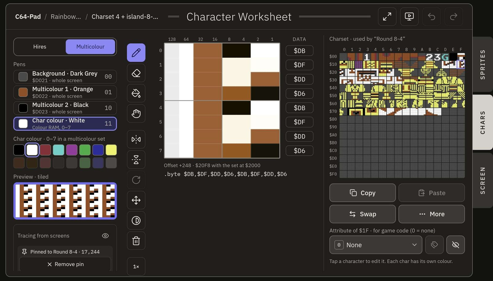

# Characters

[User guide](README.md) › Characters

On the C64, almost everything that isn't a sprite is built from
**characters** (chars): 8 × 8 pixel tiles. A **character set** (charset) holds
256 of them, and a screen is a grid of character numbers. Swap the C64's
built-in letters for your own drawings and the same screen becomes a level, a
logo or a status bar.

Charsets are edited on the **Character Worksheet**.

## The Character Worksheet

- **Left panel**: the char's number, the charset mode, this char's mode and
  colours, the pens, a tiled preview and, if any of the charset's screens has
  tracing paper, the char tracing panel.
- **Middle**: the tool rail and the 8 × 8 grid with bit headers and row
  numbers, and the DATA column (8 bytes).
- **Right**: the whole charset as a 16 × 16 sheet, with the char attributes
  underneath.

Tap a char in the sheet to edit it (or use the arrow keys on a keyboard).
Under the grid, the DATA panel also shows where this char's bytes sit
(e.g. `Offset +8 · $2008 with the set at $2000`) and a ready-made
`.byte` line you can copy.

## Charset modes

The **Charset mode** applies to all 256 chars. Change it at any time; like the
C64 itself, C64-Pad keeps the bytes and reads them the new way.

| Mode            | Pixels                 | Colours per char                                                        |
| --------------- | ---------------------- | ----------------------------------------------------------------------- |
| **Hires**       | 8 × 8                  | The background plus the char's own colour                               |
| **Multicolour** | 4 × 8, two pixels wide | Background, two shared multicolours, and the char's own colour (0 to 7) |
| **ECM**         | 8 × 8, only 64 chars   | One of four backgrounds, chosen per screen cell, plus the char's colour |
| **Bitmap**      | 4 × 8, two pixels wide | Background plus three colours of the tile's own                         |

### Hires and multicolour chars together

In a **Multicolour** charset each char can still be hires: set **This
character's mode** to **Hires** or **Multicolour**. On the C64 this is bit 3
of the char's colour, so a multicolour charset's chars can only use colours 0
to 7 as their own colour. C64-Pad keeps to that for you.

### ECM (extended colour mode)

ECM gives each screen cell a choice of **four background colours**, at the
cost of only having **64 chars**. The screen code's top two bits pick the
background, so codes `$00`, `$40`, `$80` and `$C0` all show char 0, each on
its own background. The panel lists **Screen codes using this char**, and the
four **ECM backgrounds** ($D021 to $D024).

### Multicolour bitmap

**Bitmap** turns the charset into a set of 256 **tiles** for a multicolour
bitmap screen. Each tile is 4 × 8 wide pixels with **three colours of its
own**, as well as the shared background. On the Screen Worksheet you paint
with tiles just like chars, and can change the three colours cell by cell
(see [Cell colours](06-screens.md#cell-colours-bitmap-screens)).

## Pens and colours

What the pens mean depends on the mode:

| Mode / pen                     | Bits | Colour comes from                                    |
| ------------------------------ | ---- | ---------------------------------------------------- |
| **Hires**: Background          | `0`  | $D021, the whole screen                              |
| **Hires**: Char colour         | `1`  | Colour RAM: this char's own colour                   |
| **Multicolour**: Background    | `00` | $D021, the whole screen                              |
| **Multicolour**: Multicolour 1 | `01` | $D022, the whole screen                              |
| **Multicolour**: Multicolour 2 | `10` | $D023, the whole screen                              |
| **Multicolour**: Char colour   | `11` | Colour RAM: this char's own colour, 0 to 7           |
| **ECM**: Background            | `0`  | One of four ($D021 to $D024), picked per screen cell |
| **ECM**: Char colour           | `1`  | Colour RAM: this char's own colour                   |
| **Bitmap**: Background         | `00` | $D021, the whole screen                              |
| **Bitmap**: Screen colour 1    | `01` | Screen RAM high nibble: this tile's own              |
| **Bitmap**: Screen colour 2    | `10` | Screen RAM low nibble: this tile's own               |
| **Bitmap**: Colour RAM         | `11` | Colour RAM: this tile's own                          |

Changing a whole-screen colour (the background or a multicolour) changes it
for every char in the charset. A char's own colour belongs to that char
alone: every screen cell showing it gets that colour.

## Working with the charset sheet

The buttons above the sheet:

| Button    | What it does                                                                                              |
| --------- | --------------------------------------------------------------------------------------------------------- |
| **Copy**  | Copies the selected char (a toast confirms it).                                                           |
| **Paste** | Pastes the copied char over the selected one.                                                             |
| **Swap**  | Tap **Swap**, then another char, to swap the two. Maps keep their codes, so they now show the other char. |
| **More**  | **Load PETSCII: upper case + graphics**, **Load PETSCII: lower + upper case**, **Clear all characters**.  |

Loading PETSCII or clearing replaces every char's pixels, but keeps colours,
attributes and maps. Both can be undone.

The sheet's caption says which screens use this charset.

## The tiled preview

**Preview · tiled** repeats the char in a block, so you can see how it joins
up with itself: handy for brick walls, water and other repeating patterns.

## Char attributes

Games need to know more than what a char looks like: is it solid, a ladder,
deadly? **Char attributes** let you tag each char with a number from **0 to
15** (0 means none), like CharPad's materials.

- Select a char, then pick its attribute from the **Attribute of …** menu
  under the charset sheet.
- **Name** an attribute with the tag button beside the menu (e.g. 1 =
  "solid", 2 = "ladder"). Names are kept per charset.
- The eye button (**Show attributes**) draws each char's number over the
  charset sheet. The Screen Worksheet has the same overlay over the map.

Attributes are exported as lookup tables and named labels for your code; see
[Run and export](08-run-and-export.md#charsets).

Copy, paste, swap and merge carry attributes with their chars.

## Tracing chars from a screen

If a screen that uses this charset has [tracing paper](07-tracing-paper.md),
the Character Worksheet can show the part of the image under the selected
char, so you can draw each char to match. See
[Tracing chars](07-tracing-paper.md#tracing-chars).

---

Previous: [Sprites](04-sprites.md) · Next: [Screens](06-screens.md)
