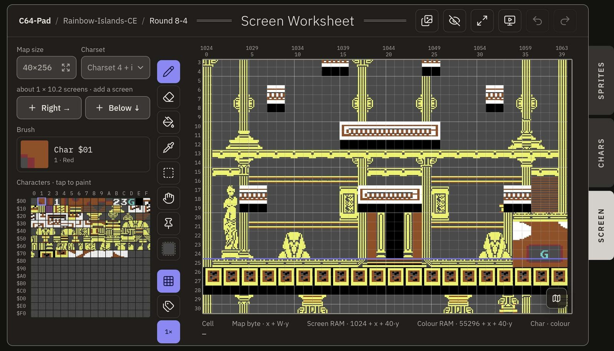

# Screens

[User guide](README.md) › Screens

A **screen map** is a grid of character numbers that uses one of the
project's charsets. One C64 screen is **40 × 25** chars, but a map can be
bigger (up to 1024 × 1024), for scrolling levels and large title screens.
Maps are drawn on the **Screen Worksheet**.

## The Screen Worksheet

- **Left panel**: the map's size and charset, the brush, and (on bitmap
  screens) the cell colours.
- **Tool rail**: the map tools.
- **The map**, with rulers along the top (column numbers, and screen RAM
  addresses on the first screen) and down the side, and a readout under it.
  Heavy lines mark where one 40 × 25 screen ends and the next begins.

Changes to the charset show up on the map straight away, so you can flip
between CHARS and SCREEN as you work.

## Map tools

| Icon                  | Tool                | What it does                                                                                           |
| --------------------- | ------------------- | ------------------------------------------------------------------------------------------------------ |
| Pencil                | **Paint**           | Stamps the brush (a char or a block). **Double-tap** to undo the stamp you just made.                  |
| Eraser                | **Erase**           | Writes the map's **Blank Char**.                                                                       |
| Paint pot             | **Fill**            | Fills the area of same chars you tap with the brush char.                                              |
| Palette               | **Colour**          | Bitmap screens only: gives cells their own colours (see [Cell colours](#cell-colours-bitmap-screens)). |
| Eyedropper            | **Pick**            | Tap the map to make that char the brush, then carry on painting.                                       |
| Dashed square         | **Select**          | Drag out a rectangle (see [Selections and block brushes](#selections-and-block-brushes)).              |
| Hand                  | **Hand**            | Drags the map around instead of painting. Pinching picks it for you.                                   |
| Pushpin               | **Pin**             | Pins the brush char to a cell for [char tracing](07-tracing-paper.md#tracing-chars).                   |
| The blank char itself | **Blank Char**      | Shows and sets which char means "empty" on this map (see below).                                       |
| Grid                  | **Grid lines**      | Shows or hides the char grid.                                                                          |
| Tag                   | **Char attributes** | Shows each cell's [char attribute](05-characters.md#char-attributes) over the map.                     |
| `1×`                  | **Zoom**            | At 1× it zooms in to 2×; when zoomed, it goes back to 1×.                                              |

Zoom and pan as on the other grids: pinch and two-finger drag, or the mouse
wheel (Shift + wheel pans sideways, Alt + wheel up and down). On small
screens some tools fold into **More tools**.

## The brush

The **Brush** panel shows the whole charset. **Tap a char to paint with it.**

With a stylus or finger, press on the charset and a **magnifier** pops up
showing the chars round your fingertip. Slide to the one you want and lift to
pick it. Lift over **Lift here to cancel** to keep the brush you had.

The brush is shown above the picker: a single char with its code and colour,
or a block (see below).

On an **ECM** charset, choose which of the four backgrounds to paint on as
well. Each char can be painted on any of them.

## The Blank Char

Each map has a **Blank Char**: the char that means "empty". **Erase** writes
it, and new cells get it when the map grows. It's `$00` by default; for a map
using a PETSCII charset `$20` (space) is usually what you want. Tap the Blank
Char button on the tool rail to change it.

## Selections and block brushes

With **Select**, drag across the map to select a rectangle. A bar appears at
the bottom-left of the map with its size and position, and:

- **Use as brush**: turns the selection into a **block brush**. Painting
  stamps the whole block, and dragging lays blocks side by side on a grid
  from where you started, like CharPad's blocks. Great for platforms, trees
  and anything bigger than a char.
- **Clear area**: fills the selection with the Blank Char.
- **Deselect**.

To go back to a single char, tap one in the brush panel or use **Pick**.

## The readout

The line under the map describes the cell under your pointer (or the one you
last touched):

| Field             | Meaning                                                             |
| ----------------- | ------------------------------------------------------------------- |
| **Cell**          | Column and row, from 0                                              |
| **Map byte**      | The cell's offset in the map data: x + width × y                    |
| **Screen RAM**    | Its address on a standard screen at 1024 ($0400): 1024 + x + 40 × y |
| **Colour RAM**    | Its colour address: 55296 ($D800) + x + 40 × y                      |
| **Char · colour** | The char's number and colour                                        |

Screen and colour RAM are only shown for cells on the first screen; on a
bigger map, other cells say _not on screen 0_.

## Map size

The left panel shows the map's size in chars and in screens.

- **Right →** adds a screen to the right (40 more columns).
- **Below ↓** adds a screen below (25 more rows).
- Tapping the size (e.g. **40×256**) opens **Resize map**: pick a size in whole screens or
  type a width and height. Content stays at the top left; new cells get the
  Blank Char, and cells outside a smaller size are cut off (you can undo
  this).

## Getting around a big map

When the map doesn't fit, a **Navigator** appears in the bottom-right corner:
the whole map in miniature (with any tracing paper), and the part you can see
boxed in yellow.

- **Tap** the Navigator to jump there.
- **Drag** the box to move the view.
- **Hide** folds it into a small map button in the corner; tap it to bring
  the Navigator back.

It fades while you paint so it doesn't get in the way. Each map reopens at the
zoom and scroll you left it at (remembered on this device).

## Changing a map's charset

Pick another charset in the left panel's **Charset** menu. C64-Pad then
renumbers the map's cells to the chars that **look the same** in the new
charset (keeping a code where it already matches), so the screen looks as it
did. It reports what changed:

- how many chars were renumbered, e.g. `$41→$02`;
- any codes with **no matching char**, which are kept as they were and may
  now look different.

ECM charsets aren't matched; their screen codes are kept. You can undo the
switch.

This is the way to move maps onto a charset made with
[Merge chars](02-projects.md#merging-charsets).

## Cell colours (bitmap screens)

On a map whose charset is in **Bitmap** mode, each cell normally takes its
tile's three colours. The **Colour** tool lets you change them cell by cell:

1. Choose the **Colour** tool.
2. In **Cell colours**, pick which colour to set: **01 Scr 1**, **10 Scr 2**
   or **11 RAM**.
3. Pick a colour, then tap or drag over cells.

**Char's own colour** takes cells back to their tile's colour. Painting other
tiles leaves cell colours where they are, so a recoloured area stays
recoloured. The readout marks cells with their own colours "(cell)".

---

Previous: [Characters](05-characters.md) · Next:
[Tracing paper](07-tracing-paper.md)
